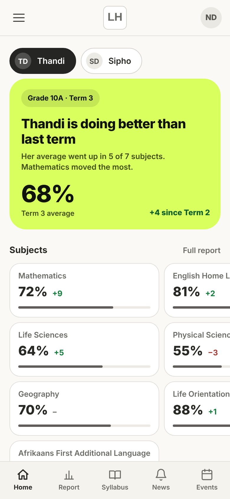

# Parent Mobile App: UI/UX Review

Review of 27 Oct 2026. Also kept as a Claude doc.

## Summary

The parent app already matches the teacher and learner phone apps closely. It has one real layout bug, no offline or refresh support, and a few small polish gaps.

- **Bug:** on Home, the subject tiles run off the right edge of the screen when a subject has a long name. A one-line CSS change fixes it.
- **Gap against the other apps:** the parent app has no offline copy, no pull to refresh and no Back-button handling. Teachers and learners now have these.
- **Polish:** one tap target is only 20px tall, and some labels are 11px.
- **Idea:** a per-subject trend across terms would answer what parents most want to know.
- **Keep as is:** the lime summary card, the neutral mark bars and the rows that expand in place.

## How the review was done

I rendered every parent screen at 390 × 844px, a typical phone, using made-up data for two children, and compared them with the teacher phone screens I had rendered earlier. I compared with the learner app by reading its code, not by looking at it.

- **Screens checked in light mode:** Home, Report (one subject expanded), Syllabus (expanded), News (expanded), Events, Add a child, the slide-in menu and the account menu.
- **Dark mode:** Home and Report.
- **Layout tests:** I tried four different sets of real South African subject names on Home, and tested the fix live in the browser.

What I could not judge:

- **Typography.** The fonts load from the internet and my test setup cannot reach them, so text showed in fallback fonts.
- **Real phones.** Back-button and touch behaviour were not tried on a device.
- **Real data.** Names, dates and marks are samples.

## What it already does well

The parent app feels like part of the same product as the teacher and learner apps, and it explains marks clearly.

- **Same visual language.** Cream page, white cards, dark buttons, teal accent, and the same bottom bar and slide-in menu as the other two apps.
- **Plain-language Home.** A one-line headline about the term, the average, and the change since last term, with no "good" or "bad" labels.
- **Clear marks.** The Report shows each subject's mark, CAPS level (1 to 7), change since last term, and how much of the term has been marked. Opening a subject lists each piece of work and says whether it counts towards the term mark, for example "Practice, not in the term mark".
- **Easy child switching.** Chips with initials sit at the top of Home, Report and Syllabus.
- **Dark mode.** Home and Report look clean in dark, with no light patches.

## Improvements, most important first

One is a bug, two are gaps against the teacher and learner apps, one is polish, and one is an optional idea.

### 1. Subject tiles run off the screen on Home (bug)

The tile grid cannot shrink below its longest subject name, so a column is pushed past the screen edge.

- In my seven-subject sample, "Afrikaans First Additional Language" sits in the left column and pushes the right column mostly off screen.
- With "Mathematical Literacy" and "Computer Applications Technology", the grid grew to 445px on a 390px screen.
- "Afrikaans First Additional Language" in the right column reaches the screen edge and removes the right margin.
- Short names, and "English Home Language", fit.
- **Fix:** make both columns `minmax(0, 1fr)`. I tried this live and long names then end with "…", for example "Computer Applicatio…". Allowing the name two lines would show it in full.

Parent Home at 390px with sample data. The right-hand tiles are cut off by the long name "Afrikaans First Additional Language".

### 2. No offline copy and no pull to refresh

The learner app's offline list names only learner pages and data, and teachers now have pull to refresh and offline marks. The parent app has neither.

- The app is read-only, so showing the last-seen Report, News and Events when there is no signal suits it well.
- Data is kept in memory for only 60 seconds, and there is no way to refresh other than reloading.

### 3. Back button

I found no Back-button handling in the parent code. Back will not close the slide-in menu first, as it now does for teachers and learners. I have not tried this on a real phone.

### 4. Small tap targets and text

- "Mark all as read" on News is 20px tall. Everything else I measured is 40px or taller. A little padding fixes it.
- Tags, weekday labels and some small notes are 11px.

### 5. Optional idea: trend across terms

Parents mostly want to know whether their child is improving over the year, but the app only compares with the previous term. A small Term 1 → 2 → 3 trend per subject would answer that. It needs the API to send all terms, so it is a feature, not polish.

## What to leave alone

Three things look different from the other apps or from common patterns, and each has a good reason to stay.

- **The lime summary card on Home.** It is the one place the parent app differs from the teacher and learner apps. It gives the answer at a glance, so I would keep it.
- **Neutral grey mark bars.** They match the app's choice never to label a result good or bad.
- **Rows that expand in place** on Report, Syllabus and News. For a read-only app there is nothing to open a separate page for.

## Suggested next steps

The tile bug and the tap target are small and safe to fix first; the rest grow in size.

| Step | What | Size | Notes |
| --- | --- | --- | --- |
| A | Fix the tile overflow (item 1) and enlarge the "Mark all as read" tap target (item 4) | Small | A few lines of CSS. Low risk. |
| B | Back button handling in the parent app (item 3) | Medium | Close the menu and sheets first, then follow the teacher and learner behaviour. Needs a test on a real phone. |
| C | Pull to refresh (item 2) | Medium | Teacher app already has it, so the approach can be reused. |
| D | Offline copy of Report, News and Events (item 2) | Larger | Needs service worker and caching rules for the parent pages and data. |
| E | Trend across terms per subject (item 5) | Largest | Needs an API change and new UI. A product decision, so it can wait. |

Suggested order: A first, then B and C together, then D. E is for later.

## Status

| Item | Status |
| --- | --- |
| 1. Subject tiles run off the screen | Fixed in PR #49. |
| 2. Pull to refresh | Done in PR #50. |
| 2. Offline copy | Done in PR #50, in a smaller form than step D above. |
| 3. Back button, 4. Tap targets and small text, 5. Trend across terms | Not started. |

**Offline copy: what changed from the plan.** Step D assumed the service worker would hold the copy. It cannot, because `service-worker.js` clears its data caches whenever `dashboard.php` or `index.php` is requested, and the parent page is served from `dashboard.php`. So the copy lives in the page instead: the last answer for each screen is kept while the app stays open, and shown with a note ("You are offline. Showing what you last saw today at 07:30.") when the server cannot be reached. The service worker is not changed. The limit is that it does not survive closing or reloading the app, and a cold start with no signal still needs the network.

**Also noticed, not changed:** the parent page does not load `pwa_prompts.js`, so an installed parent app never shows the "update available" prompt that learners and teachers get.
